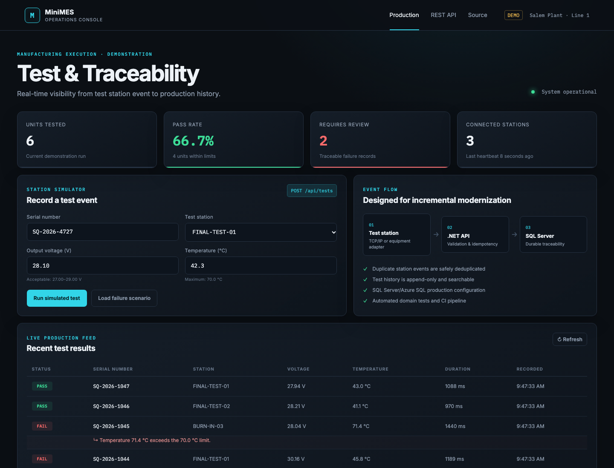
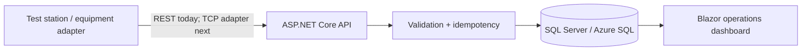

# MiniMES — Manufacturing Test & Traceability



A focused manufacturing execution system (MES) demonstration that captures test-station events, evaluates quality limits, and provides production traceability through a Blazor operations dashboard.

> **Portfolio demonstration:** This is an independent engineering project, not an official SynQor application and not based on proprietary systems or data.

## Why this project

Manufacturing software has to do more than render a dashboard. Equipment may retry messages, results must remain traceable, failures need useful reasons, and modernization cannot interrupt production. This prototype demonstrates those engineering concerns with a deliberately small workflow.

## Technology stack

- **C# / .NET 10**
- **Blazor Web App** with interactive server components
- **ASP.NET Core REST APIs**
- **Entity Framework Core 10**
- **SQL Server / Azure SQL** production provider
- **EF Core InMemory** zero-setup demonstration mode
- **xUnit** automated tests
- **Docker** container definition
- **GitHub Actions** build and test pipeline

## Demonstrated workflow

1. A station submits a test event containing a unique event ID, serial number, station, voltage, temperature, and duration.
2. The .NET service validates the request and safely handles a retried event without creating duplicate history.
3. Configured engineering limits determine Pass or Fail and generate a structured failure reason.
4. EF Core persists the append-only test record.
5. The Blazor dashboard shows production metrics, latest results, and investigation details.



## Run locally

Requires the [.NET 10 SDK](https://dotnet.microsoft.com/download/dotnet/10.0).

```bash
dotnet restore
dotnet test ManufacturingTraceability.slnx
dotnet run --project src/MiniMes.Web
```

Open the local URL printed by ASP.NET Core. With no connection string, the application uses an in-memory demonstration database and seeds representative production results.

### Use SQL Server or Azure SQL

Set the standard .NET connection-string environment variable:

```bash
export ConnectionStrings__SqlServer='Server=localhost;Database=MiniMes;User Id=sa;Password=YOUR_PASSWORD;TrustServerCertificate=True'
dotnet run --project src/MiniMes.Web
```

The application automatically selects the SQL Server provider when this value is present.

## REST API

### Record a station event

```http
POST /api/tests
Content-Type: application/json
```

```json
{
  "eventId": "15aef1cf-7569-4510-a887-253f761ffc69",
  "serialNumber": "SQ-2026-2042",
  "station": "FINAL-TEST-01",
  "outputVoltage": 28.1,
  "temperatureC": 42.3,
  "durationMs": 1240
}
```

Additional endpoints:

- `GET /api/dashboard`
- `GET /api/tests/recent?count=20`
- `GET /api/tests/serial/{serialNumber}`

## Engineering decisions

### Idempotent ingestion

`EventId` has a unique database index. When equipment retries an event, the service returns the existing record rather than duplicating production history.

### Explainable quality decisions

Failures contain the measured value and violated engineering limit. Operators and engineers see why a unit failed instead of receiving only a boolean result.

### Portable demo, production-oriented persistence

The default in-memory database keeps the interview demonstration dependable and easy to run. The same EF Core model is configured for SQL Server/Azure SQL when a connection string is supplied.

### Incremental modernization

The API boundary allows equipment adapters and newer workflows to be introduced around a legacy system one process at a time rather than requiring a risky big-bang rewrite.

## Production hardening roadmap

Before production use, I would add:

- Microsoft Entra ID authentication and role-based authorization
- Schema migrations and controlled deployment procedures
- Machine identity, signed requests, and secrets in Azure Key Vault
- Transactional event ingestion and an outbox for downstream messages
- OpenTelemetry traces, health checks, metrics, and alerting
- Configurable product-specific engineering limits
- Audit records for manual dispositions and retests
- Resilience testing for disconnects, retries, and out-of-order events
- A dedicated TCP/IP equipment adapter where required

## Tests

The test suite verifies:

- Measurements within limits produce a passing result
- Out-of-range voltage produces an explainable failure
- Retried station events are idempotent

```bash
dotnet test ManufacturingTraceability.slnx --configuration Release
```

## Discussion prompts

This prototype intentionally leaves room for requirements discovery:

- Should retests create a new attempt or supersede a previous result?
- Which measurements and limits vary by product family?
- What is the safe degraded mode if the MES or network is unavailable?
- How should operators disposition failed units?
- Which events need real-time alerts versus historical reporting?

These questions would be answered with manufacturing operators, electrical engineers, quality teams, and software owners before expanding the system.
